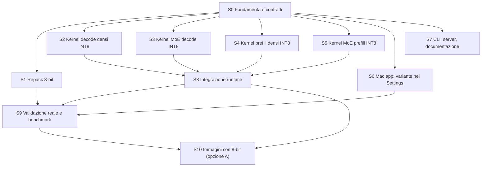

# Piano: variante 8-bit di Gemma 4 26B-A4B selezionabile nei Settings

- Versione piano: 2 (integra le decisioni dell'utente, §10)
- Data analisi: 2026-11-07
- Commit base analizzato: `d994a65` (app 0.9.4), branch `main`
- Host dell'analisi: Apple M5, 32 GB, macOS 27.2, Swift 6.4.2
- Modello 4-bit installato: `/Users/dorigo_a/LLM/TurboFieldfare/gemma4.gturbo`
  (completo, profilo `affine4` con shared expert a 4 bit; pack immagini non
  installato)
- Destinazione dell'8-bit: `/Users/dorigo_a/LLM/TurboFieldfare/gemma4-8bit.gturbo`
- Il lavoro resta nel fork: nessuna PR verso `drumih/turbo-fieldfare` (U5)

Questo documento serve a un LLM che implementa la funzionalità in **sessioni
indipendenti**. Ogni sessione ha un prompt di avvio da copiare e incollare.
Le sezioni 1–7 sono il contesto comune che ogni sessione deve leggere prima
della propria scheda (§8).

---

## 0. Come usare questo piano

1. Esegui **S0 da sola** e fai il merge in `main`. S0 fissa i contratti (§5)
   che rendono parallele le sessioni successive.
2. Esegui l'**Ondata 1** (S1–S7) in parallelo. Ogni sessione lavora sul
   proprio branch (`feat/8bit-sN-<slug>`) partendo da `main` con S0, e tocca
   solo i file che possiede (§7.2). Fai il merge di ciascuna quando i test sono
   verdi.
3. Esegui **S8** (integrazione runtime) dopo il merge di S2, S3, S4 e S5.
4. Esegui **S9** (validazione su modello reale e benchmark) dopo S1, S6 e S8.
5. **S10** (immagini con la variante 8-bit, opzione A confermata in U2) segue
   S8.

Ogni sessione scrive il proprio report in
`docs/plans/8bit-reports/SN.md` (un file per sessione, così le sessioni
parallele non vanno in conflitto). Se una sessione scopre che un fatto o un
contratto di questo piano è sbagliato, lo scrive nel proprio report alla voce
"Deviazioni dal piano" e **non** modifica questo file.

Prompt di avvio generico (ogni scheda in §8 ne contiene uno già compilato):

```text
Lavori nel repository TurboFieldfare in /Users/dorigo_a/turbo-fieldfare-fork.
Leggi AGENTS.md, poi docs/plans/8bit-model-variant-plan.md: le sezioni 1-7 e
la scheda della sessione <SN>. L'utente ti autorizza a modificare i file che
la tabella §7.2 assegna a <SN> e a crearne di nuovi nelle directory indicate
dalla scheda; non toccare altri file. Lavora sul branch feat/8bit-<sn>-<slug>
creato da main. Segui le regole comuni (§6). Alla fine scrivi
docs/plans/8bit-reports/<SN>.md con il formato di §6.4.
```

---

## 1. Obiettivo e perimetro

**Obiettivo.** Oltre al modello attuale (MLX affine 4-bit), TurboFieldfare deve
installare ed eseguire la variante **MLX affine 8-bit** dello stesso checkpoint
Gemma 4 26B-A4B IT. L'utente sceglie la variante nei Settings della Mac app; il
CLI e il server usano la variante del `.gturbo` che ricevono con `--model`.

**Definizione di fatto (DoD globale).**

- `TurboFieldfareRepack --variant int8` installa e verifica
  `gemma4-8bit.gturbo` in streaming, come oggi per il 4-bit.
- Il runtime carica entrambe le varianti e sceglie i kernel per profilo di
  quantizzazione; il percorso 4-bit resta **identico** (stessi kernel, stesso
  output token per token).
- La Mac app ha un picker "Model Variant" (4-bit / 8-bit). Ogni variante ha la
  propria posizione, il proprio download e la propria ammissione di memoria.
- Il CLI e il server funzionano con `--model <dir 8-bit>` e indicano la variante
  in log e footer.
- Test di pacchetto verdi; nuovi test dei kernel INT8 contro riferimenti CPU;
  validazione su modello reale e benchmark documentati (S9).

**Non obiettivi.** Requantizzazione locale; precisioni miste diverse da quelle
dei due checkpoint pinnati; modifica dei default del 4-bit; ottimizzazione
delle prestazioni 8-bit oltre la parità funzionale; supporto ad altri modelli;
KV cache quantizzata.

---

## 2. Fatti verificati (2026-11-07)

Verificati con l'API di Hugging Face e leggendo gli header safetensors di
tutti gli shard tramite range request (script in Appendice B).

### 2.1 Checkpoint a confronto

| Voce | 4-bit (attuale) | 8-bit (nuovo) |
| --- | --- | --- |
| Repo | `mlx-community/gemma-4-26b-a4b-it-4bit` | `mlx-community/gemma-4-26b-a4b-it-8bit` |
| Revisione pinnata | `0d77464eeb233a2da68ebf9d7dc4edaac7db956d` | `33c6d23798a0af159529890f79329206dbfbd73c` (HEAD di `main`, ultima modifica 2026-07-05) |
| SHA-256 di `model.safetensors.index.json` | `bf198c9f5ea6462addca1966e5dd669c407537a876e82cf06db9084c5c850b13` | `4b96ec862d7ae3f8d150b22b295cefcc9b5ef5e83f172f530dc1f2d2c11339cc` |
| `config.json -> quantization` | affine, `bits` 4, `group_size` 64 | affine, `bits` 8, `group_size` 64 |
| Override | 30 × `layers.N.router.proj` → 8 bit | 30 × `layers.N.router.proj` → 8 bit (uguale alla base) |
| Shard safetensors | 3, 15.341.205.776 B | 6, 27.953.641.429 B |
| Tensori | 1.697 | 1.697, **stessi nomi** |
| Tensori con dtype/shape diversi | — | 297 (solo i pesi U32 quantizzati: ultima dimensione ×2) |
| Scale/bias | BF16 `[rows, cols/64]` | BF16 `[rows, cols/64]` (identici in forma) |

Con la stessa architettura e gli stessi nomi, il planner, il manifest e il
layout esistenti descrivono già l'8-bit; cambiano solo i bit e le dimensioni.

### 2.2 Byte per categoria (payload sorgente)

| Categoria | 4-bit | 8-bit | Rapporto |
| --- | ---: | ---: | ---: |
| Embedding / LM head (tied) | 415.236.096 | 784.334.848 | 1,889 |
| Proiezioni attention | 624.476.160 | 1.179.566.080 | 1,889 |
| Shared expert (`mlp.*`) | 301.086.720 | 568.719.360 | 1,889 |
| Router (già 8-bit) | 11.665.920 | 11.665.920 | 1,000 |
| Norme e scalari BF16 | 1.224.252 | 1.224.252 | 1,000 |
| Routed experts | 12.846.366.720 | 24.265.359.360 | 1,889 |
| Vision (esclusa dal pack testo) | 1.140.925.536 | 1.142.547.552 | 1,001 |

### 2.3 Dimensioni `.gturbo` attese

| Voce | 4-bit (misurato) | 8-bit (calcolato) |
| --- | ---: | ---: |
| Payload expert per expert | 3.345.408 | 6.319.104 |
| `expertStride` (pagine da 16 KiB) | 3.358.720 | **6.324.224** |
| `layer_XX.bin` (128 expert) | 429.916.160 | 809.500.672 |
| 30 file layer | 12.897.484.800 (12,01 GiB) | 24.285.020.160 (22,62 GiB) |
| Payload residente `model_weights.bin` | ≈1.353.689.148 (+ indice = 1.353.771.068) | ≈2.545.510.460 (+ indice) |
| Installazione totale | 14.291.921.884 | ≈26,87 GB (**provvisorio**, S1 lo fissa) |
| Download stimato | 14.620.479.420 | ≈26,9–27,3 GB (**provvisorio**, S1 lo fissa con `--dry-run`) |
| Capacità slot (16 slot × 30 layer) | 1,50 GiB | 2,83 GiB |

### 2.4 Forme INT8 rilevanti per i kernel (logiche, in byte per riga)

| Tensore | Righe × colonne | Byte per riga (8-bit) |
| --- | --- | ---: |
| `embed_tokens` (anche LM head) | 262.144 × 2.816 | 2.816 |
| `q_proj` SWA / full | 4.096 / 8.192 × 2.816 | 2.816 |
| `k_proj` SWA / full | 2.048 / 1.024 × 2.816 | 2.816 |
| `v_proj` (solo SWA; nei layer full K=V) | 2.048 × 2.816 | 2.816 |
| `o_proj` SWA / full | 2.816 × 4.096 / 8.192 | 4.096 / 8.192 |
| Shared `gate`/`up` | 2.112 × 2.816 | 2.816 |
| Shared `down` | 2.816 × 2.112 | 2.112 |
| Router | 128 × 2.816 | 2.816 |
| Routed `gate`/`up` (per expert) | 704 × 2.816 | 2.816 |
| Routed `down` (per expert) | 2.816 × 704 | 704 |

### 2.5 Blob di un expert 8-bit (ordine del planner: gate, up, down × weights, scales, biases)

| Sotto-tensore | Offset | Dimensione |
| --- | ---: | ---: |
| `gate` | 0 | 1.982.464 |
| `gate_scales` | 1.982.464 | 61.952 |
| `gate_biases` | 2.044.416 | 61.952 |
| `up` | 2.106.368 | 1.982.464 |
| `up_scales` | 4.088.832 | 61.952 |
| `up_biases` | 4.150.784 | 61.952 |
| `down` | 4.212.736 | 1.982.464 |
| `down_scales` | 6.195.200 | 61.952 |
| `down_biases` | 6.257.152 | 61.952 |
| Fine payload / stride | 6.319.104 / 6.324.224 | |

Tutti gli offset sono multipli di 16 e la base di ogni slot è allineata a
2 MiB: nei kernel routed INT8 le righe dei pesi sono **allineate a 16 byte**.

---

## 3. Stato del codice: cosa è già generico e cosa è cablato a 4 bit

### 3.1 Per area

| Area | File principali | Stato oggi | Azione |
| --- | --- | --- | --- |
| Formato `.gturbo` v1 | `Sources/TurboFieldfareFormat/*` | Il manifest ha già `quant.<slot>.weightBits`; il layout ha `bits` per sotto-tensore | Nessuna; il formato resta v1.0 |
| Planner del repack | `Sources/TurboFieldfareRepack/Core/Planning/RepackPlanner.swift` | Generico: legge i bit da `config.json`, calcola le forme logiche con `32/bits` | Allineamento residente INT8 (S1) |
| Sorgente pinnata | `SupportedModelSource.swift`, `SourceFingerprint.swift` | Solo 4-bit | Catalogo varianti (S0), CLI (S1) |
| Manifest nel repack | `RemoteStreamingRepacker.writeManifest` | Bit per slot ricavati dal piano, con default 4/4/8/8/4 | Nessun default silenzioso (S1) |
| Validazione manifest runtime | `ManifestReader.validateQuant` | Rifiuta l'8-bit per embedding, attention e routed | Profili `affine4`/`affine8` (S0) |
| Schema in `Model.load` | `Runtime/Inference/Model.swift` | Generico 4/8 bit; allineamento dei pesi 8-bit = 1 byte | Allineamento 16 B per l'8-bit (S8) |
| Router | `MoE.swift` + `moe.metal` (`router_gemv_gemma4_r4`) | Già INT8 in entrambi i checkpoint | Nessuna |
| Shared expert | `SharedExpertRuntime` (`SharedExpertInt4.swift`, `SharedExpertInt8.swift`), `PrefillSharedExpert` | Già 4 e 8 bit | Nessuna |
| Kernel decode densi | `dequant_int4.metal`, `logit.metal`, `fused` | Solo INT4 | Kernel INT8 (S2) |
| MoE routed decode | `moe.metal` (`moe_phase1_*`, `moe_phase2_*`) | Solo INT4 | Kernel INT8 (S3) |
| Prefill denso | `prefill.metal`, `tensorops.metal` | Solo INT4 | Kernel INT8 (S4) |
| MoE routed prefill | `prefill.metal` (`prefill_grouped_routed_moe_batched_*`) | Solo INT4 | Kernel INT8 (S5) |
| Selezione kernel | `RealForwardRunner.swift` | Istanzia solo le classi `*Int4` | Dispatch per profilo (S8) |
| Streaming degli expert | `PreadExpertStreamer.swift`, `ModelExpertIO.swift` | Generico (usa `expertStride`) | Nessuna |
| Ammissione memoria | `ContextAdmission.swift` | Costanti misurate sul 4-bit (`expertStrideBytes = 3_358_720`, 2 GiB) | `ModelFootprint` per profilo (S0) |
| Mac app | `AppModelInstallDescriptor`, `AppModelInstallationProbe`, `AppModelLocation`, `MacAppSettings`, `AppModel`, `TurboFieldfareMacApp` | Un solo descrittore, un solo percorso, probe legato allo SHA del 4-bit | Variante nei Settings (S6) |
| Decode service | `DecodeLoadAdmission.swift` | Ammissione con costanti 4-bit | Footprint dal manifest (S6) |
| CLI / server | `TurboFieldfareCLI/Run.swift`, `ServerArguments.swift` | `--model` generico; ammissione 4-bit | Footprint e variante nei log (S7) |
| Cronologia chat | `ConversationIdentity`, `ConversationContinuability` | `modelID` diverso → `cannotReplay(.differentModel)` | Solo messaggio più chiaro (S6) |
| Vision | `RemoteVisionPackInstaller`, `VisionRuntime` | Pack legato allo SHA del manifest testo, non al repo; proiettore INT4 via MPP | Opzione A: riuso del pack 4-bit (S10) |

### 3.2 Inventario dei kernel INT4 da affiancare con INT8

| Kernel Metal INT4 | Wrapper Swift | Uso | Gemello INT8 | Sessione |
| --- | --- | --- | --- | --- |
| `embed_lookup_int4` | `EmbedLookupInt4` | Embedding decode | `embed_lookup_int8` / `EmbedLookupInt8` | S2 |
| `dequant_int4_qkv_gemv_simd` | `FusedQKVGEMV` | QKV decode | `dequant_int8_qkv_gemv_simd` / `FusedQKVGEMVInt8` | S2 |
| `dequant_int4_gemv_simd` | `DequantInt4GEMV` | `o_proj`, testa logits, GEMV ripetuta in prefill | **esiste già** `dequant_int8_gemv_simd` / `DequantInt8GEMV` (stessa firma); servono le specializzazioni per le forme `o_proj` e testa | S2 |
| `lm_head_greedy_int4_rows_chunk_raw` + `_reduce` | `LMHeadChainInt4` | Testa greedy fusa | `lm_head_greedy_int8_rows_chunk_raw` / `LMHeadChainInt8` (riusa il reduce se è indipendente dai bit) | S2 |
| (usa `DequantInt4GEMV`) | `PrefillFinalRowHeadInt4` | Testa dell'ultima riga del prefill | `PrefillFinalRowHeadInt8` su `DequantInt8GEMV` | S2 |
| `moe_phase1_gate_up_act_u16load`, `moe_phase1_gate_up_act_subset_u16load`, `moe_phase2_down_reduce_k8` | `MoE` | MoE routed decode | `moe_phase1_gate_up_act_int8`, `moe_phase1_gate_up_act_subset_int8`, `moe_phase2_down_reduce_k8_int8` | S3 |
| `prefill_embed_lookup_int4_block` | `PrefillEmbedLookupInt4` | Embedding prefill | `prefill_embed_lookup_int8_block` / `PrefillEmbedLookupInt8` | S4 |
| `prefill_dequant_int4_qmm_f16_block` | `PrefillInt4QMM` | Proiezioni prefill | `prefill_dequant_int8_qmm_f16_block` / `PrefillInt8QMM` | S4 |
| `mpp_prefill_affine_threadgroup_f16` (+ varianti apple10) | `MPPPrefillInt4QMM` | Proiezioni Q/KV/O del prefill con MPP | `mpp_prefill_affine8_threadgroup_f16` / `MPPPrefillInt8QMM` | S4 |
| `prefill_grouped_routed_moe_batched_phase1`, `_down` | `PrefillGroupedRoutedMoE` | MoE routed prefill | `..._phase1_int8`, `..._down_int8` | S5 |

Restano invariati: router (`router_gemv_gemma4_r4`, `prefill_router_gemma4_block`,
già INT8), shared expert (4/8), attention, RoPE, RMSNorm, sampling, KV cache.

---

## 4. Decisioni di design

| ID | Decisione | Motivo |
| --- | --- | --- |
| D1 | Sorgente = checkpoint MLX 8-bit pinnato per revisione e SHA dell'indice; copia byte per byte come per il 4-bit | Mantiene l'invariante "il repack non dequantizza né riquantizza" |
| D2 | Due soli **profili**: `affine4` = {embedding 4, attention 4, router 8, shared 4 o 8, routed 4}; `affine8` = {tutti 8}. Ogni altra combinazione è rifiutata al load | Superficie di test finita; fail-closed |
| D3 | Kernel INT8 in **file e funzioni nuovi**; nessuna modifica ai kernel INT4 | Zero rischio di regressione sul percorso 4-bit, molto ottimizzato. La duplicazione è accettata |
| D4 | `RealForwardRunner` sceglie i kernel per profilo tramite i protocolli definiti in S0 (C3), o un enum equivalente | S8 diventa uno scambio meccanico; le sessioni kernel lavorano in parallelo |
| D5 | Directory distinte: `gemma4.gturbo` (4-bit) e `gemma4-8bit.gturbo` (8-bit); il pack immagini segue la regola esistente `<stem>.vision.gturbo` | Nessuna collisione; si possono tenere installate entrambe |
| D6 | Settings: picker "Model Variant" nel menu Settings e riga "Variant" nell'Inspector. Ogni variante ricorda il proprio percorso. Il campo legacy `selectedModelPath` resta il percorso **4-bit** | Il downgrade dell'app continua a funzionare |
| D7 | Le chat restano legate alla variante (già garantito da `ConversationIdentity.modelID`); si migliora solo il messaggio. **Confermata (U3)** | Gli ID token coincidono, ma la regola fail-closed esistente va rispettata |
| D8 | Ammissione memoria per profilo: 4-bit = costanti misurate attuali; 8-bit = stima prudente provvisoria (minimo pratico 16 GB), calibrata in S9. Sotto la soglia l'8-bit è **bloccato**, non solo sconsigliato. **Confermata (U1)** | Gli 8 GB non bastano per l'8-bit; si riusa il meccanismo di rifiuto esistente |
| D9 | Immagini con l'8-bit: opzione A (pack dalla sorgente 4-bit, legato al manifest 8-bit). L'opzione B resta solo come ripiego. **Confermata (U2)** | Il binding è già per SHA del manifest; la torre è BF16 in entrambi; cambia solo il proiettore |
| D10 | Il formato resta `.gturbo` v1.0; nessun nuovo flag | Il manifest esprime già i bit per slot; i build precedenti rifiutano l'8-bit da soli (fail-closed in `validateQuant`) |
| D11 | **Obbligatorio:** per il profilo `affine8` il repacker allinea a 16 byte l'offset di ogni peso quantizzato residente (padding a zero tra le entry). Il layout 4-bit resta byte-identico. Il runtime rifiuta un'installazione `affine8` non allineata | Oggi gli offset residenti possono essere allineati solo a 2 byte (`layer_scalar` è di 2 byte); i kernel INT8 possono così usare load a 4 byte |

---

## 5. Contratti condivisi tra sessioni

Questi contratti permettono alle sessioni dell'Ondata 1 di non dipendere l'una
dall'altra. S0 li crea; le altre sessioni li usano senza modificarli.

### C1 — Catalogo varianti (S0, `TurboFieldfareRepackCore`)

File nuovo `Sources/TurboFieldfareRepack/Core/Remote/SupportedModelVariant.swift`:

```swift
public enum SupportedModelVariant: String, CaseIterable, Codable, Sendable {
    case int4, int8
    public var displayName: String          // "Gemma 4 26B-A4B IT 4-bit" / "... 8-bit"
    public var shortLabel: String           // "4-bit" / "8-bit"
    public var repoID: String
    public var revision: String
    public var sourceIndexSHA256: String
    public var approximateDownloadBytes: UInt64   // int8: provvisorio, S1 lo fissa
    public var installedBytes: UInt64             // int8: provvisorio, S1 lo fissa
    public var reserveBytes: UInt64               // 1 GiB per entrambi
    public var defaultDirectoryName: String       // "gemma4.gturbo" / "gemma4-8bit.gturbo"
    public var recommendedMinimumHostMemoryBytes: UInt64  // 8 GiB / 16 GiB
    public func installOptions(outputDirectory: URL, overwrite: Bool,
                               token: String?, resume: Bool) -> RemoteStreamingRepackOptions
    public static func variant(forSourceIndexSHA256 hex: String) -> SupportedModelVariant?
    public static func variant(forSourceSnapshotHash value: String) -> SupportedModelVariant? // "sha256:<hex>"
    public static func variant(forRepoID id: String) -> SupportedModelVariant?
}
```

`SupportedModelSource` resta come alias pubblico di `.int4` (API pubblica
invariata). `SourceFingerprint.knownFingerprints` deriva da tutti i casi.

### C2 — Profilo di quantizzazione (S0, `TurboFieldfare`)

File nuovo `Sources/TurboFieldfare/Infrastructure/ModelIO/QuantProfile.swift`:

```swift
public enum QuantProfile: String, Sendable, Equatable {
    case affine4, affine8
    public init(manifestQuant: ManifestQuant) throws   // regole di D2, altrimenti ModelError.indexCorrupt
    public var denseWeightBits: Int    // embedding, attention, testa: 4 / 8
    public var routedWeightBits: Int   // 4 / 8
}
extension Model { public var quantProfile: QuantProfile { get } }
```

### C3 — Protocolli dei kernel affini (S0, interni a `TurboFieldfare`)

File nuovo `Sources/TurboFieldfare/Kernels/Quant/AffineKernelContracts.swift`.
Ogni protocollo ha come unico requisito la **firma esatta** del metodo del
wrapper INT4 esistente (stesse etichette, tipi e default). S0 fa conformare le
classi INT4 con estensioni vuote; le sessioni kernel fanno conformare le classi
INT8 nei **propri** file nuovi.

| Protocollo | Metodo (firma copiata da) | Conformi INT4 (S0) | Conformi INT8 |
| --- | --- | --- | --- |
| `AffineGEMVEncoding` | `DequantInt4GEMV.encode(...)` | `DequantInt4GEMV`, `DequantInt8GEMV` | — (già S0) |
| `AffineEmbedLookupEncoding` | `EmbedLookupInt4.encode(...)` | `EmbedLookupInt4` | `EmbedLookupInt8` (S2) |
| `AffineFusedQKVEncoding` | `FusedQKVGEMV.encode(...)` | `FusedQKVGEMV` | `FusedQKVGEMVInt8` (S2) |
| `AffineGreedyHeadEncoding` | `LMHeadChainInt4.encodeGreedyDecode(...)` | `LMHeadChainInt4` | `LMHeadChainInt8` (S2) |
| `AffinePrefillFinalRowHeadEncoding` | `PrefillFinalRowHeadInt4.encodeLogits(...)` | `PrefillFinalRowHeadInt4` | `PrefillFinalRowHeadInt8` (S2) |
| `AffinePrefillEmbedEncoding` | `PrefillEmbedLookupInt4.encode(...)` | `PrefillEmbedLookupInt4` | `PrefillEmbedLookupInt8` (S4) |
| `AffinePrefillQMMEncoding` | `PrefillInt4QMM.encode(...)` | `PrefillInt4QMM` | `PrefillInt8QMM` (S4) |
| `AffineMPPPrefillQMMEncoding` | `MPPPrefillInt4QMM.encode(...) -> PathMetadata` + `isAvailable` | `MPPPrefillInt4QMM` | `MPPPrefillInt8QMM` (S4) |

Per MoE si estendono le classi esistenti invece di crearne di nuove:

- S3: `MoE.init(context:routedWeightBits: Int = 4)`; i metodi `encodeRouted*`
  mantengono nomi e firme e, con 8 bit, usano le pipeline INT8.
- S5: `PrefillGroupedRoutedMoE.init(context:weightBits: Int = 4)`, con lo
  stesso schema.

### C4 — Moduli Metal pre-registrati (S0)

`MetalContext` concatena i moduli condivisi in un'unica sorgente, nell'ordine
di `shaderModules`. S0 crea i file segnaposto (solo `#include <metal_stdlib>`,
`using namespace metal;` e un commento con la sessione proprietaria) e li
registra **in coda**:

| Modulo | File | Libreria | Proprietario |
| --- | --- | --- | --- |
| `dequant_int8_dense` | `Sources/TurboFieldfare/Metal/Quant/dequant_int8_dense.metal` | condivisa | S2 |
| `moe_int8` | `Sources/TurboFieldfare/Metal/MoE/moe_int8.metal` | condivisa | S3 |
| `prefill_int8` | `Sources/TurboFieldfare/Metal/Prefill/prefill_int8.metal` | condivisa | S4 |
| `prefill_moe_int8` | `Sources/TurboFieldfare/Metal/Prefill/prefill_moe_int8.metal` | condivisa | S5 |
| `tensorops_int8` | `Sources/TurboFieldfare/Metal/TensorCore/tensorops_int8.metal` | privata (`privateLibrary`), solo in `shaderSubdirectories`; contenuto dentro `#if defined(__HAVE_TENSOR__)` | S4 |

Regole per tutto il codice Metal nuovo:

- Ogni simbolo nuovo (kernel, funzione inline, costante, struct) ha nome
  univoco con suffisso o prefisso `int8`, perché la sorgente condivisa è unica.
- I moduli nuovi vengono dopo `moe.metal` e `prefill.metal` e **possono
  riusare** le loro struct, gli helper e le function constant (per esempio
  `PrefillStreamedRoutedBlobsMSL`, `PrefillGroupedRoutedMoEStreamedParamsMSL`,
  `prefill_streamed_local_expert_id`, `prefill_gelu_pytorch_tanh`, gli helper
  `moe_fc_*` e gli indici 0–3 di `moe.metal`) senza ridefinirli.
- Indici di function constant nuovi, per non collidere con quelli in uso
  (0–3, 10–13, 20–26, 30–31, 40–43, 50–53, 60–65, 69–73, 76, 80–86):
  S2 100–109, S3 110–119, S4 120–129, S5 130–139.

### C5 — Layout dei byte INT8 (MLX affine 8-bit)

- Peso: tensore `U32 [rows, cols/4]`, letto come byte. Il byte `k` della riga
  (little-endian nelle parole a 32 bit) è il valore quantizzato della colonna
  `k`: `q ∈ [0, 255]`.
- Dequantizzazione: `w = float(q) * scale[g] + bias[g]`, con `g = k / 64`;
  `scales`/`biases` sono BF16 `[rows, cols/64]`. Il pattern è quello di
  `dequant_int8_gemv_simd` e del router: `acc += s * dot(q, x) + b * sum(x)`
  per gruppo.
- Righe: `cols` byte. Tutte le forme di §2.4 hanno righe multiple di 16 byte.
- Allineamento garantito:
  - pesi routed nel blob: 16 byte (§2.5), base dello slot a 2 MiB;
  - pesi residenti `affine8`: 16 byte (D11, garantito da S1, verificato da S8);
  - scale/bias: 2 byte.
- I kernel INT8 possono assumere **al massimo 4 byte** di allineamento per la
  base dei pesi (margine di sicurezza) e devono rispettare gli offset passati
  dal chiamante.

### C6 — Impronta di memoria per profilo (S0, `ContextAdmission`)

```swift
public struct ModelFootprint: Sendable, Equatable {
    public let nonKVRuntimeBytes: UInt64   // affine4: 2 << 30 (misurato); affine8: 4 << 30 (provvisorio)
    public let expertStrideBytes: Int      // 3_358_720 / 6_324_224
    public let hostReserveBytes: UInt64    // affine4: 3 << 30; affine8: 5 << 30 (provvisorio)
    public static let affine4Measured: ModelFootprint
    public static let affine8Provisional: ModelFootprint
    public static func forProfile(_ p: QuantProfile) -> ModelFootprint
    public static func forModelDirectory(_ url: URL) throws -> ModelFootprint  // legge solo il manifest
}
```

Tutte le funzioni pubbliche di `ContextAdmission` ricevono
`footprint: ModelFootprint` con default `.affine4Measured`, oppure un overload
se i test di compatibilità dell'API pubblica lo richiedono. Con il default i
risultati devono restare identici a oggi.

Con questi valori un contesto 8-bit da 4K richiede circa 9,3 GiB: un Mac da
8 GB viene rifiutato dal meccanismo esistente, uno da 16 GB è ammesso. S9
calibra i valori.

### C7 — Nomi e chiavi

- CLI del repack: `--variant int4|int8` (default `int4`) e `--dry-run`
  (metadati e piano, nessun payload).
- Directory di default: `scratch/gemma4.gturbo` e `scratch/gemma4-8bit.gturbo`
  in un checkout; in `~/Library/Application Support/TurboFieldfare/` per l'app
  standalone.
- `MacAppSettings`: nuova chiave `modelVariant` (`"int4"`/`"int8"`, default
  `int4`) e nuova chiave `selectedModelPathInt8`. `selectedModelPath` resta il
  percorso 4-bit. Campi additivi, senza aumentare `currentVersion` (come
  `sidebarVisible`).
- Etichette UI: "4-bit" e "8-bit"; titolo del picker "Model Variant".
- `modelID` nel manifest: il repo ID della variante (lo imposta già
  `SourceFingerprint`): è anche il `model` del server OpenAI-compatibile.

### C8 — Test e tolleranze

- Riferimenti CPU in `Sources/TurboFieldfareValidation/Support/Reference/`
  (esistono già `DequantInt8Gemv.swift`, `DequantInt4Gemv.swift`,
  `EmbedLookup.swift`, `MoE/Moe.swift`); i riferimenti INT8 nuovi vanno in
  **file nuovi** della stessa cartella.
- Fixture INT8 generate con `Quantization.quantizeInt8Affine` e con il PRNG
  esistente (`SeedTree`, `SplitMix64`).
- Tolleranze: quelle di `Tolerances.swift` usate dai test INT4 gemelli. Se
  servono tolleranze nuove, aggiungile in un file nuovo e giustificale nel
  report.

---

## 6. Regole comuni a tutte le sessioni

### 6.1 Dal file AGENTS.md (vincolanti)

- Modifica solo ciò che la tua scheda autorizza; non cambiare i default del
  runtime e non avviare ottimizzazioni non richieste.
- Test: solo con `Scripts/test.sh` (seriale), eventualmente `--filter <Suite>`.
  Un solo processo app/CLI/test che usa il modello alla volta.
- Prima di qualsiasi esecuzione su modello reale verifica: macOS 26+, Swift
  6.2+, spazio disco sufficiente, `memory_pressure -Q` accettabile, `.gturbo`
  completo, e nessun processo da
  `pgrep -fl 'TurboFieldfareServer|TurboFieldfareMac|TurboFieldfareDecodeService|TurboFieldfareCLI|TurboFieldfarePackageTests|swiftpm-testing-helper|mlx_lm|mlx-lm'`.
  Se un controllo fallisce: avvisa e fermati; non terminare processi, non
  cancellare e non reinstallare modelli.
- Non scaricare checkpoint completi, non duplicare `.gturbo` e non svuotare
  cache solo per eseguire test. Il download 8-bit (~27 GB) è approvato una
  sola volta, per S9 (U4), verso
  `/Users/dorigo_a/LLM/TurboFieldfare/gemma4-8bit.gturbo`. Nessun'altra
  sessione scarica il checkpoint senza una nuova richiesta esplicita.
- SwiftUI: usa `@StoredState` e `PreviewProvider`; niente `@State` diretto né
  macro `#Preview`. Se tocchi queste superfici esegui
  `ruby Scripts/check_swiftui_macros.rb --self-test` e
  `ruby Scripts/tests/swift_macro_probe_test.rb`.
- Server solo su `127.0.0.1`.
- Percorso immagini fail-closed: se il pack manca o non è valido, il supporto
  immagini è "unavailable".

### 6.2 Specifiche di questo piano

- Codice, commenti, nomi, messaggi di commit e testi UI in **inglese**, nello
  stile del repository.
- Non modificare i file e i kernel INT4 esistenti, salvo le eccezioni della
  tua scheda. Verifica a fine sessione che
  `git diff main -- Sources/TurboFieldfare/Metal/Quant/dequant_int4.metal Sources/TurboFieldfare/Metal/MoE/moe.metal Sources/TurboFieldfare/Metal/Prefill/prefill.metal Sources/TurboFieldfare/Metal/TensorCore/tensorops.metal Sources/TurboFieldfare/Metal/Sampling/logit.metal`
  sia vuoto.
- Mantieni l'API pubblica compatibile: `PublicAPISignatureCompatibilityTests`
  deve restare verde. Si possono aggiungere API, non rimuoverle né rinominarle.
- Nessuna struttura dati grande del modello nello heap Swift (invariante del
  progetto): fixture piccole sì, pesi reali no.
- Le sessioni parallele girano in worktree o branch separati: in quei checkout
  il modello non c'è e i test che lo richiedono si saltano da soli. I test su
  modello reale si fanno solo in S8 e S9, nel checkout principale e in serie.
- Modelli reali: i `.gturbo` stanno in `/Users/dorigo_a/LLM/TurboFieldfare/`,
  non in `scratch/`. Per soddisfare il controllo di AGENTS.md ("completed
  `scratch/gemma4.gturbo`") senza duplicare i modelli, crea in `scratch/` dei
  **symlink** (`scratch/gemma4.gturbo` e, dopo S9, `scratch/gemma4-8bit.gturbo`)
  verso quelle cartelle: il runtime accetta un percorso modello che è un
  symlink. In alternativa passa il percorso con `--model` e riportalo nel
  report come deviazione dal protocollo.

### 6.3 Commit

- Commit piccoli e coerenti sul branch della sessione, messaggi in inglese.
- Terminano con la riga di attribuzione richiesta dall'ambiente, se presente.
- Il lavoro resta nel fork (U5): nessuna PR verso `drumih/turbo-fieldfare`.
  Nessun push e nessuna PR nemmeno nel fork senza richiesta esplicita
  dell'utente.

### 6.4 Formato del report (`docs/plans/8bit-reports/SN.md`)

1. Riepilogo (3–5 righe).
2. File creati o modificati.
3. Test eseguiti: comandi esatti ed esito; per i test di kernel, gli errori
   massimi osservati.
4. Deviazioni dal piano, con motivazione e impatto sulle altre sessioni.
5. Valori misurati o fissati (per esempio dimensioni, stride, tempi).
6. Problemi aperti o follow-up.

---

## 7. Dipendenze e proprietà dei file

### 7.1 Grafo



| Ondata | Sessioni | Dimensione indicativa |
| --- | --- | --- |
| 0 | S0 | M |
| 1 (parallela) | S1, S2, S3, S4, S5, S6, S7 | S1 M, S2 L, S3 M-L, S4 L, S5 M, S6 L, S7 M |
| 2 | S8 | L |
| 3 | S9 | M (+ tempo di download) |
| 4 | S10 | S (opzione A) |

### 7.2 Proprietà dei file

Ogni file ha un solo proprietario per ondata. "Nuovo" vuol dire che la
sessione crea il file.

| Sessione | File che può modificare o creare |
| --- | --- |
| S0 | Nuovi: `Sources/TurboFieldfareRepack/Core/Remote/SupportedModelVariant.swift`, `Sources/TurboFieldfare/Infrastructure/ModelIO/QuantProfile.swift`, `Sources/TurboFieldfare/Kernels/Quant/AffineKernelContracts.swift`, i 5 file Metal segnaposto di C4, test nuovi. Modifiche: `SupportedModelSource.swift`, `SourceFingerprint.swift`, `ManifestReader.swift`, `Model.swift` (solo `quantProfile`), `RealForwardRunner.swift` (solo la guardia d'ingresso), `ContextAdmission.swift`, `MetalContext.swift` (registro moduli), `Tests/TurboFieldfare/Core/Infrastructure/ModelIO/ManifestReaderTests.swift`, `Tests/TurboFieldfare/Core/Runtime/Configuration/ContextAdmissionTests.swift` |
| S1 | `Sources/TurboFieldfareRepack/Command/main.swift`, `Sources/TurboFieldfareRepack/Core/**` (non `SupportedModelSource.swift`), solo i valori int8 di `SupportedModelVariant.swift`, `Tests/TurboFieldfareRepack/**` |
| S2 | `Metal/Quant/dequant_int8_dense.metal`, `Kernels/Quant/DequantInt8GEMV.swift` (solo nuove specializzazioni), nuovi `Kernels/Quant/EmbedLookupInt8.swift`, `Kernels/Fusions/FusedQKVGEMVInt8.swift`, `Kernels/Fusions/LMHeadChainInt8.swift`, `Kernels/Prefill/Epilogues/PrefillFinalRowHeadInt8.swift`, nuovi riferimenti in `TurboFieldfareValidation/Support/Reference/Quant/`, nuovi test in `Tests/TurboFieldfare/Core/Kernels/Quant8/` |
| S3 | `Metal/MoE/moe_int8.metal`, `Kernels/MoE/MoE.swift`, nuovi riferimenti in `Reference/MoE/`, nuovi test in `Tests/TurboFieldfare/Core/Kernels/MoE/` |
| S4 | `Metal/Prefill/prefill_int8.metal`, `Metal/TensorCore/tensorops_int8.metal`, nuovi `Kernels/Prefill/Primitives/PrefillPrimitivesInt8.swift` e `Kernels/TensorCore/MPPPrefillInt8QMM.swift`, nuovi test in `Tests/TurboFieldfare/Core/Kernels/Prefill/` e `Tests/TurboFieldfare/Core/Kernels/TensorCore/` |
| S5 | `Metal/Prefill/prefill_moe_int8.metal`, `Kernels/Prefill/MoE/PrefillGroupedRoutedMoE.swift`, nuovi test in `Tests/TurboFieldfare/Core/Kernels/Prefill/` |
| S6 | `Sources/TurboFieldfareApp/**`, `Sources/TurboFieldfareDecodeService/DecodeLoadAdmission.swift`, `Tests/TurboFieldfareApp/**`, `Tests/TurboFieldfareDecodeService/DecodeLoadAdmissionTests.swift` |
| S7 | `Sources/TurboFieldfareCLI/**`, `Sources/TurboFieldfareServer/**`, i relativi test, `README.md`, `AGENTS.md`, `docs/SYSTEM_DESIGN.md`, `docs/RUNTIME_CONTROLS.md`, `docs/OPENAI_SERVER.md`, `docs/COMMUNITY_BENCHMARKS.md` |
| S8 | `Runtime/Inference/RealForwardRunner.swift`, `Runtime/Inference/Model.swift` (validazione allineamento), test di integrazione nuovi |
| S9 | `docs/BENCHMARKS.md`, valori `affine8` in `ContextAdmission.swift` e nei relativi test, riga 8-bit della tabella "At a glance" del `README.md`, `docs/plans/8bit-reports/S9.md` |
| S10 | `Sources/TurboFieldfareRepack/Core/Remote/RemoteVisionPackInstaller.swift`, `RepackPlanner.planVisionCompanion` (solo opzione B), file vision dell'app e del runtime, test vision |

I percorsi `Metal/...` e `Kernels/...` sono relativi a `Sources/TurboFieldfare/`.

---

## 8. Schede delle sessioni

### S0 — Fondamenta e contratti

**Prerequisiti:** nessuno. **Va eseguita da sola e mergiata prima di tutte le altre.**

**Obiettivo.** Creare i contratti C1–C4 e C6 senza cambiare il comportamento
del 4-bit e mantenendo l'8-bit *fail-closed*: un `.gturbo` 8-bit viene
riconosciuto, ma il runner rifiuta di eseguirlo finché non c'è S8.

**Leggi prima:** `ManifestReader.swift`, `Model.swift` (righe 1–120 e
`validateRuntimeSchema`), `RealForwardRunner.swift` (`init`),
`ContextAdmission.swift`, `MetalContext.swift` (righe 125–215),
`SupportedModelSource.swift`, `SourceFingerprint.swift`, e le firme `encode`
dei wrapper elencati in C3.

**Task.**

1. Crea `SupportedModelVariant` (C1) con i valori di §2.1. Per `int8`:
   `approximateDownloadBytes = 27_300_000_000` e
   `installedBytes = 26_900_000_000`, marcati `// provisional: pinned by S1`.
   Riscrivi `SupportedModelSource` come facciata di `.int4` (stesse proprietà
   pubbliche, stessi valori). `SourceFingerprint.knownFingerprints` copre
   entrambe le varianti.
2. Crea `QuantProfile` (C2) e `Model.quantProfile`. In
   `ManifestReader.validateQuant` sostituisci gli insiemi di bit per slot con
   `QuantProfile(manifestQuant:)`; mantieni i controlli su schema
   (`affine`), tipi di scale/bias (`bf16`) e `groupSize == 64`.
3. Nella prima riga di `RealForwardRunner.init` aggiungi una guardia:
   per un profilo diverso da `affine4` lancia un errore tipizzato e
   descrittivo (per esempio "8-bit runtime kernels are not integrated yet").
   Rendila testabile come funzione statica
   (`RealForwardRunner.requireSupportedProfile(_:)`). Nient'altro cambia nel
   runner.
4. Crea `AffineKernelContracts.swift` (C3) con i protocolli e le conformità
   INT4 tramite estensioni vuote. Nessun call site cambia.
5. Crea i 5 file Metal segnaposto (C4), registra i 4 moduli condivisi in coda a
   `shaderModules`, registra tutti e 5 in `shaderSubdirectories`. Verifica che
   la libreria condivisa compili (con un qualsiasi test di kernel) e che
   `MetalContext.privateLibrary(device:module: "tensorops_int8")` compili.
6. Implementa `ModelFootprint` (C6) e la parametrizzazione di
   `ContextAdmission`; sostituisci la costante privata `expertStrideBytes` con
   `footprint.expertStrideBytes`. Con `.affine4Measured` ogni risultato resta
   identico a oggi.
7. Test:
   - `ManifestReaderTests`: accetta `affine8`; rifiuta i mix (per esempio
     embedding 8 + routed 4, attention 8 + embedding 4, routed 8 + resto 4).
   - Nuovi `QuantProfileTests` e `SupportedModelVariantTests`: lookup per SHA,
     per `sha256:<hex>` e per repo ID; la facciata `SupportedModelSource` ha
     gli stessi valori di prima.
   - `ContextAdmissionTests`: valori 4-bit invariati; l'8-bit rifiuta 8 GB e
     ammette 16 GB a 4K e 8K.
   - Test della guardia del runner.

**Accettazione.** `Scripts/test.sh` verde, incluso
`PublicAPISignatureCompatibilityTests`; `git diff --stat` limitato ai file di
§7.2; nessun kernel INT4 modificato.

**Fuori perimetro.** Kernel INT8, UI, repack CLI, documentazione.

**Prompt di avvio.**

```text
Lavori nel repository TurboFieldfare in /Users/dorigo_a/turbo-fieldfare-fork.
Leggi AGENTS.md, poi docs/plans/8bit-model-variant-plan.md: le sezioni 1-7 e
la scheda S0. L'utente ti autorizza a modificare i file che la tabella §7.2
assegna a S0 e a creare quelli indicati; non toccare altri file. Lavora sul
branch feat/8bit-s0-foundation creato da main. Implementa i contratti C1, C2,
C3, C4 e C6 esattamente come specificati, mantenendo identico il
comportamento 4-bit e l'8-bit fail-closed. Esegui Scripts/test.sh e scrivi
docs/plans/8bit-reports/S0.md con il formato di §6.4.
```

---

### S1 — Installer e repack 8-bit

**Prerequisiti:** S0.

**Obiettivo.** Installare `gemma4-8bit.gturbo` dal checkpoint 8-bit pinnato,
con resume, verifica e allineamento residente a 16 byte (D11); fissare le
dimensioni reali nel catalogo.

**Leggi prima:** `Command/main.swift`, `RepackPlanner.swift`,
`RangeCopyPlanner.swift`, `ResidentWriter.swift`,
`RemoteStreamingRepacker.swift` (`run`, `runPrepared`, `writeManifest`),
`RemoteSnapshotLoader.swift`, `IndexLoader.swift`, `GTurboJSON.swift`,
`Tests/TurboFieldfareRepack/Core/Support/SyntheticSnapshot.swift` e i test
`RemotePayloadCopyTests*`.

**Task.**

1. `--variant int4|int8` (default `int4`) per install, resume e discard; testo
   di `--help` aggiornato; messaggi finali con `variant.displayName`.
   `--verify-install` resta indipendente dalla variante. I comandi vision non
   cambiano (S10).
2. `--dry-run`: scarica solo metadati e header, esegue il piano con
   `dryRunSpaceCheck: true` e stampa `remoteBytesToDownload`, byte di output
   (residente + layer), `expertStride`, bit per slot e numero di tensori vision
   esclusi. Nessun payload.
3. D11: quando il profilo sorgente è `affine8` (tutti i `.weight` quantizzati a
   8 bit), allinea a 16 byte l'offset di ogni peso quantizzato residente,
   riempiendo con zeri. Il piano 4-bit deve restare **byte-identico**: aggiungi
   un test che confronta piano o fingerprint 4-bit prima e dopo. Verifica che
   `RangeCopyPlanner` e `ResidentWriter` gestiscano destinazioni non contigue,
   e che resume e digest dei range funzionino.
4. `writeManifest`: niente valori di default silenziosi. Se uno slot non si
   ricava dal piano, lancia un errore.
5. Esegui `--dry-run --variant int8` sulla rete. Servono solo pochi MB, ed è
   consentito: sono metadati, non un checkpoint completo. Verifica:
   `expertStride == 6_324_224`; file layer da 809.500.672 byte; tutti gli slot
   a 8 bit; 358 tensori vision esclusi. Aggiorna i valori `int8` di
   `SupportedModelVariant`: `installedBytes` = byte di output più file
   tokenizer, manifest, receipt e layout, arrotondato per eccesso;
   `approximateDownloadBytes` = valore del dry run più i file piccoli. Documenta
   il metodo nel commento.
6. Test sintetici: `SyntheticSnapshot` con parametro `bits` (4/8); test di
   piano, manifest e layout 8-bit (campo `bits: 8`, forme logiche = packed ×
   4, stride corretto, allineamento residente a 16 B), resume e checkpoint
   8-bit, accettazione della fingerprint 8-bit, rifiuto di una sorgente 8-bit
   con SHA dell'indice sconosciuto.
7. Non installare il checkpoint reale: il download approvato (U4) appartiene a
   S9. Se l'utente lo chiede espressamente in questa sessione, installa in
   `/Users/dorigo_a/LLM/TurboFieldfare/gemma4-8bit.gturbo` (così S9 lo riusa)
   e lancia `--verify-install`, dopo aver verificato lo spazio disco.

**Accettazione.** Test del repack verdi; output del dry run nel report; piano
4-bit invariato; nessun file fuori da §7.2.

**Fuori perimetro.** Runtime, app, documentazione (S7 documenta i flag),
vision.

**Prompt di avvio.**

```text
Lavori nel repository TurboFieldfare in /Users/dorigo_a/turbo-fieldfare-fork.
Leggi AGENTS.md, poi docs/plans/8bit-model-variant-plan.md: le sezioni 1-7 e
la scheda S1. L'utente ti autorizza a modificare i file che §7.2 assegna a S1.
Lavora sul branch feat/8bit-s1-repack creato da main (che contiene S0).
Puoi usare la rete per i soli metadati (dry run). NON scaricare il checkpoint
completo senza chiedere conferma all'utente. Esegui Scripts/test.sh --filter
TurboFieldfareRepackTests, poi la suite completa, e scrivi
docs/plans/8bit-reports/S1.md.
```

---

### S2 — Kernel decode densi INT8

**Prerequisiti:** S0.

**Obiettivo.** Avere i gemelli INT8 di embedding, QKV fusa, testa greedy e
testa dell'ultima riga del prefill, e verificare `DequantInt8GEMV` sulle forme
di `o_proj` e della testa logits.

**Leggi prima:** `Metal/Quant/dequant_int4.metal`,
`Metal/Quant/dequant_int8.metal`, `Metal/Sampling/logit.metal` (righe 600–787),
`EmbedLookupInt4.swift`, `FusedQKVGEMV.swift`, `LMHeadChainInt4.swift`,
`PrefillFinalRowHead.swift`, `DequantInt8GEMV.swift` e i test gemelli
`DequantInt4GEMVTests`, `EmbedLookupTests`, `FusedQKVGEMVTests`,
`LMHeadChainInt4Tests`, `PrefillFinalRowHeadTests`.

**Task.**

1. In `dequant_int8_dense.metal`:
   - `embed_lookup_int8`: stessa semantica di `embed_lookup_int4`, incluso
     `outScale` (`sqrt(H)`);
   - `dequant_int8_qkv_gemv_simd`: stessa geometria di dispatch e stessi
     binding del gemello INT4, incluso il caso dei layer full-attention (K=V,
     senza `v_proj`): controlla come lo gestisce il wrapper INT4;
   - `lm_head_greedy_int8_rows_chunk_raw`: stesso contratto di output del
     gemello INT4. Riusa `lm_head_greedy_int4_rows_reduce` se lavora solo sui
     risultati parziali e non dipende dai bit; altrimenti crea un reduce INT8.
2. Wrapper Swift nuovi che si conformano a C3: `EmbedLookupInt8`,
   `FusedQKVGEMVInt8`, `LMHeadChainInt8`, `PrefillFinalRowHeadInt8` (su
   `DequantInt8GEMV` + RMSNorm come il gemello INT4).
3. `DequantInt8GEMV`: aggiungi le specializzazioni per (m=2.816, n=4.096),
   (2.816, 8.192) e (262.144, 2.816), con o senza function constant come fa il
   gemello INT4, **senza cambiare** le varianti esistenti (router e shared
   expert le usano).
4. Riferimenti CPU nuovi, se mancano (embedding INT8), in
   `Reference/Quant/`.
5. Test in `Tests/TurboFieldfare/Core/Kernels/Quant8/`: forme di produzione di
   §2.4; offset dei pesi multipli di 4 ma non di 16 (esercita C5); dati
   casuali da `quantizeInt8Affine`; argmax della testa greedy uguale al
   riferimento CPU (sottoinsieme del vocabolario e vocabolario completo);
   embedding con token ai bordi (0, V-1).
6. Annota nel report le prestazioni grezze (tempo GPU per chiamata delle forme
   principali, 4-bit contro 8-bit) come informazione, non come obiettivo.

**Accettazione.** Test nuovi e vecchi verdi; kernel INT4 intatti (§6.2);
indici di function constant tra 100 e 109.

**Fuori perimetro.** `RealForwardRunner`; MoE; prefill multi-riga.

**Prompt di avvio.**

```text
Lavori nel repository TurboFieldfare in /Users/dorigo_a/turbo-fieldfare-fork.
Leggi AGENTS.md, poi docs/plans/8bit-model-variant-plan.md: le sezioni 1-7 e
la scheda S2. L'utente ti autorizza a modificare i file che §7.2 assegna a S2.
Lavora sul branch feat/8bit-s2-decode-dense creato da main (che contiene S0).
Non modificare i kernel INT4 né RealForwardRunner. Esegui i test con
Scripts/test.sh --filter <suite> e alla fine la suite completa; scrivi
docs/plans/8bit-reports/S2.md.
```

---

### S3 — Kernel MoE routed decode INT8

**Prerequisiti:** S0.

**Obiettivo.** Avere le fasi routed del decode (gate/up/attivazione, full e
subset, down + riduzione pesata) per gli expert INT8, selezionabili da
`MoE(routedWeightBits: 8)`.

**Leggi prima:** `Metal/MoE/moe.metal` (tutto), `Kernels/MoE/MoE.swift`,
`ModelExpertIO.swift` (`routedExpertOffsets`), `MoEFusedFFNTests.swift`,
`Reference/MoE/Moe.swift`, e §2.5 di questo piano.

**Task.**

1. In `moe_int8.metal`: `moe_phase1_gate_up_act_int8`,
   `moe_phase1_gate_up_act_subset_int8`, `moe_phase2_down_reduce_k8_int8`, con
   gli **stessi binding e lo stesso layout di argument buffer** dei gemelli
   INT4, così `makeRoutedArgumentBuffer` e `makeReusedRoutedArgumentBuffer`
   restano validi. Riusa helper e function constant di `moe.metal` (C4). Le
   righe sono di 2.816 B (gate/up) e 704 B (down), allineate a 16 B: puoi
   usare load vettoriali da 4 o 16 byte.
2. `MoE.init(context:routedWeightBits: Int = 4)`: valida {4, 8}; con 8 bit
   costruisce le pipeline INT8 (generiche e specializzate con le costanti di
   produzione D=2816, F=704, topK=8). Router invariato; nomi e firme dei
   metodi `encodeRouted*` invariati.
3. Se `MoE` ha asserzioni o precondizioni legate al 4-bit (per esempio
   allineamenti `u16load`), rendile dipendenti dai bit senza cambiarle per il
   4-bit.
4. Riferimento CPU INT8 per la FFN routed (nuovo file in `Reference/MoE/` o
   parametro `bits` aggiunto in modo retrocompatibile).
5. Test nuovi: blob sintetici INT8 con gli offset di §2.5; top-8 con pesi;
   percorsi full, subset hit/miss e riduzione; confronto con il riferimento
   CPU; anche con `routedWeightBits: 4`, per dimostrare che il 4-bit non
   cambia.

**Accettazione.** Test verdi; `moe.metal` invariato; indici di function
constant nuovi tra 110 e 119.

**Fuori perimetro.** `RealForwardRunner`, prefill, streamer.

**Prompt di avvio.**

```text
Lavori nel repository TurboFieldfare in /Users/dorigo_a/turbo-fieldfare-fork.
Leggi AGENTS.md, poi docs/plans/8bit-model-variant-plan.md: le sezioni 1-7 e
la scheda S3. L'utente ti autorizza a modificare i file che §7.2 assegna a S3.
Lavora sul branch feat/8bit-s3-moe-decode creato da main (che contiene S0).
Non modificare moe.metal né RealForwardRunner. Esegui Scripts/test.sh
--filter per le suite MoE, poi la suite completa; scrivi
docs/plans/8bit-reports/S3.md.
```

---

### S4 — Kernel prefill densi INT8 (incluso MPP)

**Prerequisiti:** S0.

**Obiettivo.** Avere i gemelli INT8 di embedding a blocchi, QMM del prefill e
proiezione MPP con staging FP16.

**Leggi prima:** `Metal/Prefill/prefill.metal` (righe 1–60 e 660–730),
`Metal/TensorCore/tensorops.metal` (righe 1–112 e 201–430),
`Kernels/Prefill/Primitives/PrefillPrimitives.swift`,
`Kernels/TensorCore/MPPPrefillInt4QMM.swift`,
`RealForwardRunner.swift` (`encodeInt4Projection`, righe ~750–810, solo per
capire l'uso), e i test `PrefillAffineTests`, `PrefillPrimitiveTests`,
`MPPPrefillInt4QMMTests`.

**Task.**

1. `prefill_int8.metal`: `prefill_embed_lookup_int8_block` e
   `prefill_dequant_int8_qmm_f16_block`, con la stessa geometria dei gemelli.
2. `tensorops_int8.metal` (libreria privata):
   `mpp_prefill_affine8_threadgroup_f16`, che dequantizza una tile INT8 in
   staging FP16 nella threadgroup memory e chiama `matmul2d` con gli stessi
   tile M/N/K dei gemelli. La variante apple10 è facoltativa: se la ometti,
   `MPPPrefillInt8QMM` usa il percorso `control`.
3. Wrapper nuovi conformi a C3: `PrefillEmbedLookupInt8`, `PrefillInt8QMM`
   (in `PrefillPrimitivesInt8.swift`) e `MPPPrefillInt8QMM`, con la stessa
   semantica di `Path`/`PathMetadata` (anche il fallback quando MPP non è
   disponibile). Puoi riusare i tipi annidati di `MPPPrefillInt4QMM` se è
   pulito; altrimenti crea tipi equivalenti.
4. Test: T ∈ {1, 31, 32, 128, 256} con le forme Q/KV/O e shared di §2.4;
   confronto con il riferimento CPU e con `DequantInt8GEMV` riga per riga;
   test di disponibilità e fallback MPP.

**Accettazione.** Test verdi; `prefill.metal` e `tensorops.metal` invariati;
indici di function constant tra 120 e 129.

**Fuori perimetro.** MoE del prefill (S5), runner.

**Prompt di avvio.**

```text
Lavori nel repository TurboFieldfare in /Users/dorigo_a/turbo-fieldfare-fork.
Leggi AGENTS.md, poi docs/plans/8bit-model-variant-plan.md: le sezioni 1-7 e
la scheda S4. L'utente ti autorizza a modificare i file che §7.2 assegna a S4.
Lavora sul branch feat/8bit-s4-prefill-dense creato da main (che contiene
S0). Non modificare prefill.metal, tensorops.metal né RealForwardRunner.
Esegui Scripts/test.sh --filter per le suite Prefill e TensorCore, poi la suite
completa; scrivi docs/plans/8bit-reports/S4.md.
```

---

### S5 — Kernel MoE routed del prefill INT8

**Prerequisiti:** S0.

**Obiettivo.** Avere le due fasi batched del MoE routed del prefill per
expert INT8, selezionabili da `PrefillGroupedRoutedMoE(weightBits: 8)`.

**Leggi prima:** `Metal/Prefill/prefill.metal` (righe 330–480 e 590–670),
`Kernels/Prefill/MoE/PrefillGroupedRoutedMoE.swift`,
`PrefillRoutedTileScheduler.swift`, i test
`PrefillGroupedRoutedMoETests*`, e §2.5.

**Task.**

1. `prefill_moe_int8.metal`: `prefill_grouped_routed_moe_batched_phase1_int8`
   e `prefill_grouped_routed_moe_batched_down_int8`, che riusano struct e helper
   di `prefill.metal` (C4); stessi indici di buffer.
2. `PrefillGroupedRoutedMoE.init(context:weightBits: Int = 4)`: valida {4, 8}
   e sceglie le pipeline; metadati e argument buffer invariati.
3. Test gemelli di `+Execution` e `+Binding` con blob INT8 (offset di §2.5),
   più microbatch e tile da 8 e 16 expert; confronto con il riferimento CPU.

**Accettazione.** Test verdi; `prefill.metal` invariato; indici di function
constant tra 130 e 139.

**Prompt di avvio.**

```text
Lavori nel repository TurboFieldfare in /Users/dorigo_a/turbo-fieldfare-fork.
Leggi AGENTS.md, poi docs/plans/8bit-model-variant-plan.md: le sezioni 1-7 e
la scheda S5. L'utente ti autorizza a modificare i file che §7.2 assegna a S5.
Lavora sul branch feat/8bit-s5-prefill-moe creato da main (che contiene S0).
Non modificare prefill.metal né RealForwardRunner. Esegui Scripts/test.sh
--filter PrefillGroupedRoutedMoE, poi la suite completa; scrivi
docs/plans/8bit-reports/S5.md.
```

---

### S6 — Mac app: scelta della variante nei Settings

**Prerequisiti:** S0. Si può sviluppare e testare con client finti; il
caricamento reale dell'8-bit funziona solo dopo S8 (prima mostra l'errore
chiaro della guardia di S0).

**Obiettivo.** L'utente sceglie "4-bit" o "8-bit" nei Settings; l'app usa la
directory, il descrittore di download, il probe d'installazione e
l'ammissione di memoria della variante scelta.

**Leggi prima:** `AppModel.swift` (init, righe 240–330; posizione e load,
righe 860–1060; `currentSettings`), `MacAppSettings.swift`,
`AppModelLocation.swift`, `AppModelInstallDescriptor.swift`,
`AppModelInstallationProbe.swift`, `ExistingModelSelection.swift`,
`RepackModelInstallerClient.swift`, `AppContextLengthOption.swift`,
`TurboFieldfareMacApp.swift` (`CommandMenu("Settings")`), `InspectorView.swift`
(`modelSection`, `memorySection`), `ModelInstallView.swift`,
`ConversationSidebarPresentation.swift`, `DecodeLoadAdmission.swift`, e i test
in `Tests/TurboFieldfareApp/Core/Installation` e
`Tests/TurboFieldfareApp/Core/Configuration`.

**Task.**

1. **Descrittori:**
   `AppModelInstallDescriptor.descriptor(for: SupportedModelVariant)`, con i
   dati del catalogo C1; `.default` resta il 4-bit. `visionCompanion` non
   cambia (S10).
2. **Settings persistiti** (C7): `modelVariant` e `selectedModelPathInt8`,
   additivi con `decodeIfPresent`; `isValid()` controlla il nuovo percorso;
   `selectedModelPath` resta il percorso 4-bit. Test: un file vecchio senza le
   chiavi viene letto come `int4`; round-trip; un'app vecchia che legge un file
   nuovo trova ancora il percorso 4-bit.
3. **Posizioni:** `AppModelLocation` calcola il default per variante (stesso
   genitore, nome da `defaultDirectoryName`). `validate(.download)` usa il
   descrittore della variante; `.existing` accetta qualunque variante nota.
4. **Probe:** `AppModelInstallationProbe.detectVariant(at:)`, dal
   `sourceSnapshotHash` del manifest. `ExistingModelSelection` mostra la
   variante di ogni candidato; scegliere un candidato dell'altra variante
   cambia `modelVariant`.
5. **AppModel:** stato `modelVariant` e `setModelVariant(_:)`, abilitato alle
   stesse condizioni di `canChangeModelLocation`. Flusso: salva i settings,
   poi `changeModelURL(percorso della variante)` (il metodo esistente già
   scarica il modello, rilascia il KV e ricollega la cronologia), poi aggiorna
   readiness, installer e descrittore. L'installer va per variante (factory
   iniettabile nei test oppure descrittore passato a ogni chiamata).
   Con `TURBO_FIELDFARE_MODEL_PATH` o un URL esplicito, la variante si ricava
   dal manifest e il picker è disabilitato con una spiegazione.
6. **Ammissione:** `AppContextLengthOption` e `AppModel.admittedContext` usano
   `ModelFootprint.forProfile` della variante. Al cambio di variante si
   ricalcolano le opzioni di contesto e si applica il clamp con il notice
   esistente. Sotto la soglia della variante, Load è disabilitato e il messaggio
   arriva da `ContextAdmission.needDescription` (blocco confermato in U1; il
   download resta possibile, ma la UI dice che su questo Mac il modello non si
   può caricare).
7. **Decode service:** `DecodeLoadAdmission` usa
   `ModelFootprint.forModelDirectory` del modello da caricare.
8. **UI:**
   - nel menu `Settings`, un `Picker("Model Variant")` con le voci "4-bit" e
     "8-bit" e identificatori di accessibilità, disabilitato quando non si può
     cambiare;
   - nell'Inspector, sezione Model, una riga "Variant";
   - download e "Expected installed" della variante corrente;
   - in `ModelInstallView`, per l'8-bit, la nota "~27 GB download; 16 GB
     memory recommended".
   Rispetta le regole SwiftUI di §6.1.
9. **Cronologia:** per `.differentModel`, se il `modelID` registrato
   corrisponde a una variante nota, il testo diventa "recorded with the 4-bit
   model" (o 8-bit), suggerendo di cambiare variante per continuare. Nessun
   cambiamento alla regola di continuabilità.
10. **Test:** settings; posizioni per variante; probe e detect; selezione di un
    modello esistente con cambio di variante; `setModelVariant` (unload,
    percorso, descrittore, readiness); ammissione per variante; testo della
    cronologia; `DecodeLoadAdmissionTests`. Per le prove manuali usa
    `TURBO_FIELDFARE_APP_DATA_PATH` puntato a una directory temporanea.

**Accettazione.** Test app e decode service verdi; i due script SwiftUI di
§6.1 verdi; nessun file fuori da §7.2; comportamento 4-bit invariato con i
settings esistenti.

**Fuori perimetro.** Runtime e kernel; vision per l'8-bit (S10); CLI e server.

**Prompt di avvio.**

```text
Lavori nel repository TurboFieldfare in /Users/dorigo_a/turbo-fieldfare-fork.
Leggi AGENTS.md, poi docs/plans/8bit-model-variant-plan.md: le sezioni 1-7 e
la scheda S6. L'utente ti autorizza a modificare i file che §7.2 assegna a S6.
Lavora sul branch feat/8bit-s6-app-settings creato da main (che contiene S0).
Usa client e installer finti nei test; non scaricare modelli. Esegui
Scripts/test.sh --filter TurboFieldfareAppTests e --filter
TurboFieldfareDecodeServiceTests, gli script SwiftUI di AGENTS.md, poi la suite
completa; scrivi docs/plans/8bit-reports/S6.md.
```

---

### S7 — CLI, server e documentazione

**Prerequisiti:** S0. I nomi dei flag del repack sono fissati da C7, quindi
S7 non dipende da S1.

**Obiettivo.** CLI e server indicano la variante e la usano per l'ammissione;
la documentazione descrive le due varianti.

**Task.**

1. CLI (`Run.swift`, `Args.swift`): ammissione con
   `ModelFootprint.forModelDirectory`; il footer temporale (e `--help`) indica
   `variant: 4-bit|8-bit`; l'output resta compatibile per chi lo analizza
   (aggiungi una riga, non cambiare quelle esistenti).
2. Server (`ServerArguments.swift` e avvio): ammissione con il footprint; il
   log di avvio stampa variante e `modelID`; verifica che il `model` atteso
   nelle richieste sia il `modelID` del manifest (per l'8-bit
   `mlx-community/gemma-4-26b-a4b-it-8bit`) e che `/v1/models`, se esiste, lo
   riporti.
3. Documentazione: tabella "At a glance" del `README.md` con le due varianti
   (la riga 8-bit dice "experimental, pending validation" finché S9 non
   pubblica i numeri); comandi `--variant int8` e `--dry-run`; requisiti di
   disco e RAM; `docs/SYSTEM_DESIGN.md` (sorgenti pinnate, tabella delle
   risorse 8-bit da §2.3, quantizzazione per profilo, ammissione per profilo);
   `docs/RUNTIME_CONTROLS.md` (costo degli slot per variante);
   `docs/OPENAI_SERVER.md` (model ID 8-bit); `docs/COMMUNITY_BENCHMARKS.md`
   (campo "variant" obbligatorio nei report); `AGENTS.md` (comandi 8-bit e
   regola dei test "completed `scratch/gemma4.gturbo` or
   `scratch/gemma4-8bit.gturbo`"). Esegui
   `ruby Scripts/check_markdown_links.rb`.
4. Test: unit test di CLI e server per ammissione e stringa di variante.

**Accettazione.** Test di CLI e server verdi; link Markdown validi; nessun
numero 8-bit presentato come misurato se è una stima.

**Prompt di avvio.**

```text
Lavori nel repository TurboFieldfare in /Users/dorigo_a/turbo-fieldfare-fork.
Leggi AGENTS.md, poi docs/plans/8bit-model-variant-plan.md: le sezioni 1-7 e
la scheda S7. L'utente ti autorizza a modificare i file che §7.2 assegna a S7.
Lavora sul branch feat/8bit-s7-cli-server-docs creato da main (che contiene
S0). Usa i nomi di C7 per i flag del repack anche se S1 non è ancora
mergiata. Esegui i test di CLI e server con Scripts/test.sh --filter, poi
ruby Scripts/check_markdown_links.rb e la suite completa; scrivi
docs/plans/8bit-reports/S7.md.
```

---

### S8 — Integrazione runtime 8-bit

**Prerequisiti:** S0, S2, S3, S4 e S5 in `main`. S1 serve solo per la prova su
modello reale.

**Obiettivo.** `RealForwardRunner` esegue decode e prefill con il profilo
`affine8`; il 4-bit resta identico.

**Leggi prima:** `RealForwardRunner.swift` (tutto), `Model.swift`
(`validateRuntimeSchema`), i report S2–S5 in `docs/plans/8bit-reports/` e i
wrapper INT8 che hanno introdotto.

**Task.**

1. In `init`, scegli i kernel per profilo (C3):
   - decode: embedding, QKV fusa, `o_proj` (`AffineGEMVEncoding`), testa
     greedy, testa logits;
   - MoE: `MoE(context:routedWeightBits:)`;
   - shared expert e router: invariati (`sharedExpertWeightBits` esiste già);
   - prefill: embedding, `encodeInt4Projection` rinominata
     `encodeAffineProjection` con MPP/QMM/GEMV della famiglia giusta,
     `PrefillGroupedRoutedMoE(weightBits:)`, testa dell'ultima riga.
   Il codice del percorso 4-bit chiama gli stessi oggetti con gli stessi
   argomenti di prima.
2. Rimuovi la guardia di S0 per `affine8`; lasciane una per i profili
   sconosciuti.
3. In `Model.validateRuntimeSchema`, per `affine8`, verifica che gli offset dei
   pesi quantizzati residenti siano multipli di 16 (D11) e fallisci con un
   errore chiaro ("reinstall with a current TurboFieldfareRepack"). Per
   `affine4` nulla cambia. Aggiungi i casi in
   `Tests/TurboFieldfare/Core/Infrastructure/ModelIO/ModelRuntimeSchemaValidationTests.swift`.
4. Test model-free: se esiste un harness con architettura ridotta, cerca
   `ArchConfig(` nei test e aggiungi un gemello `affine8` di un passo di
   decode e di un chunk di prefill contro il riferimento. Se non esiste,
   documentalo e affidati ai test dei kernel più la prova reale.
5. Regressione 4-bit sul modello installato
   `/Users/dorigo_a/LLM/TurboFieldfare/gemma4.gturbo` (con i controlli e il
   symlink di §6.1-§6.2): esegui la stessa raw completion greedy su `main` e
   sul branch e verifica che l'output sia **identico** token per token. Per
   esempio:
   `swift run -c release TurboFieldfareCLI --model scratch/gemma4.gturbo --prompt "The capital of France is" --max-new 64 --temperature 0`
6. Prova 8-bit (solo se è già installato; S8 non lo scarica): stesso prompt,
   poi `--chat-prompt`;
   confronta `--prefill off` con il prefill chunked sui primi token greedy e
   documenta le differenze; prova con 8 e 16 slot.

**Accettazione.** Suite completa verde; identità 4-bit dimostrata, o motivata
se il modello non è disponibile; con il modello 8-bit disponibile, output
coerente e nessun crash.

**Prompt di avvio.**

```text
Lavori nel repository TurboFieldfare in /Users/dorigo_a/turbo-fieldfare-fork.
Leggi AGENTS.md, poi docs/plans/8bit-model-variant-plan.md: le sezioni 1-7, la
scheda S8 e i report docs/plans/8bit-reports/S0..S5.md. L'utente ti autorizza a
modificare i file che §7.2 assegna a S8. Lavora sul branch
feat/8bit-s8-runtime creato da main (che contiene S0-S5). Prima di ogni
esecuzione su modello reale applica i controlli di AGENTS.md ed esegui un solo
processo alla volta. Scrivi docs/plans/8bit-reports/S8.md.
```

---

### S9 — Validazione su modello reale, calibrazione e benchmark

**Prerequisiti:** S1, S6 e S8 in `main`. Il download da ~27 GB è approvato
dall'utente (U4) verso `/Users/dorigo_a/LLM/TurboFieldfare/gemma4-8bit.gturbo`;
se quella installazione esiste già, riusala.

**Task.**

1. Controlli preliminari (§6.1) e spazio disco (≥ 29 GB liberi; il 2026-11-07
   erano liberi 232 GiB).
2. Installa con
   `swift run -c release TurboFieldfareRepack --variant int8 --output /Users/dorigo_a/LLM/TurboFieldfare/gemma4-8bit.gturbo`
   (oppure dall'app), poi `--verify-install`. Crea il symlink
   `scratch/gemma4-8bit.gturbo` di §6.2.
3. Correttezza:
   - output greedy deterministici sui prompt di `docs/benchmark-prompts`;
   - confronto 4-bit/8-bit sui logits del primo token generato (similarità
     coseno, accordo top-1 e top-5) su almeno 20 prompt (informativo, non
     vincolante);
   - prefill chunked contro prefill disattivato;
   - multi-turno nell'app con `TURBO_FIELDFARE_APP_DATA_PATH` temporaneo;
   - cambio di variante nell'app con entrambi i modelli installati.
4. Memoria: footprint fisico a 4K e 8K con 16 e 32 slot. Aggiorna
   `ModelFootprint.affine8Provisional` (rinominalo `affine8Measured` se lo
   ritieni opportuno, mantenendo un alias) e i test relativi.
5. Benchmark: segui **esattamente** `docs/COMMUNITY_BENCHMARKS.md` per entrambe
   le varianti, senza controlli sperimentali né profiling. Riporta commit,
   hardware, RAM, macOS, versione di Swift, comando esatto, exit code, footer
   temporale completo o errore, e ogni deviazione dal protocollo.
6. Aggiorna `docs/BENCHMARKS.md` (sezione 8-bit: misure, non tetti di
   prestazione) e la riga 8-bit della tabella "At a glance" del `README.md`.

**Prompt di avvio.**

```text
Lavori nel repository TurboFieldfare in /Users/dorigo_a/turbo-fieldfare-fork.
Leggi AGENTS.md, docs/COMMUNITY_BENCHMARKS.md e
docs/plans/8bit-model-variant-plan.md (sezioni 1-7, §10, scheda S9, report
S1, S6 e S8). L'utente ha approvato il download del checkpoint 8-bit (~27 GB)
verso /Users/dorigo_a/LLM/TurboFieldfare/gemma4-8bit.gturbo (decisione U4);
riusalo se esiste già. Applica i controlli preliminari di AGENTS.md prima di
ogni esecuzione ed esegui un solo processo modello alla volta. Lavora sul
branch feat/8bit-s9-validation. Scrivi docs/plans/8bit-reports/S9.md.
```

---

### S10 — Immagini con la variante 8-bit

**Prerequisiti:** S8; S9 per i test reali (modello 8-bit installato).

**Opzione A (scelta dall'utente, U2).** Il pack immagini viene dalla sorgente 4-bit
(torre BF16 identica, proiettore INT4) ed è legato al manifest 8-bit. Il
binding attuale usa lo SHA e il `sourceSnapshotHash` del manifest testo, non
il repo, quindi dovrebbe funzionare quasi senza modifiche.

1. Verifica, con test e fixture di manifest 8-bit, che
   `RemoteVisionPackInstaller`, `VisionPackVerifier`,
   `AppVisionPackInstallationProbe` e `VisionRuntime` accettino un pack di
   origine 4-bit accanto a `gemma4-8bit.gturbo`
   (`gemma4-8bit.vision.gturbo`).
2. App: sezione "Image Support" per la variante 8-bit con il descrittore
   esistente.
3. Documentazione: "with the 8-bit model the image projector stays 4-bit".
4. Con il modello reale: una prova CLI con `--image` e una nell'app.

**Opzione B (solo se A non dà una qualità accettabile).** Pack dalla
sorgente 8-bit: `planVisionCompanion` accetta `baseBits == 8` e
1.142.547.552 byte; proiettore INT8 con un kernel MPP BF16
(`mpp_prefill_affine8_threadgroup_bf16_apple10_v1`); `VisionRuntime` sceglie il
proiettore in base ai bit del pack; il formato vision registra i bit del
proiettore.

**Prompt di avvio.**

```text
Lavori nel repository TurboFieldfare in /Users/dorigo_a/turbo-fieldfare-fork.
Leggi AGENTS.md, poi docs/plans/8bit-model-variant-plan.md: le sezioni 1-7, la
scheda S10 e i report S8 e S9. Implementa l'opzione A (decisione U2); proponi l'opzione B solo
con evidenze di qualità insufficiente. Mantieni il percorso immagini
fail-closed. Lavora sul branch feat/8bit-s10-vision e scrivi
docs/plans/8bit-reports/S10.md.
```

---

## 9. Rischi e mitigazioni

| Rischio | Impatto | Mitigazione |
| --- | --- | --- |
| Il decode 8-bit legge il doppio dei byte per ogni expert mancato e il doppio per la testa | Tok/s più bassi, circa 0,5–0,7× del 4-bit dove dominano i miss (stima da misurare) | Accettato (non obiettivo); misura in S9; più slot su Mac con molta RAM |
| Mac da 8 GB | Thrashing | `ModelFootprint` 8-bit rifiuta 8 GB; nota UI; S9 calibra |
| Disco: ~27 GB in più | Installazione fallita | Controllo disco del descrittore; dry run |
| La revisione HF cambia | Installazione non riproducibile | Pin per revisione e SHA dell'indice (già il meccanismo) |
| Allineamento residente INT8 | Letture disallineate e risultati errati | D11 obbligatorio, validazione in S8, kernel con assunzione ≤ 4 B |
| Simboli Metal duplicati nella sorgente concatenata | Libreria che non compila | Nomi univoci e range di function constant (C4) |
| Conflitti di merge tra sessioni parallele | Tempo perso | Proprietà dei file (§7.2), report separati |
| Regressione 4-bit | Il percorso principale peggiora | Kernel INT4 intoccati, prova di identità token per token (S8) |
| Rottura dell'API pubblica | Test di compatibilità rossi | Solo aggiunte e overload (§6.2) |
| Build precedenti davanti a un `.gturbo` 8-bit | Errore poco chiaro | Il rifiuto fail-closed esiste già; la doc lo spiega (S7) |
| Chat registrate con l'altra variante | L'utente non capisce perché non continuano | Messaggio specifico (S6); regola invariata (D7) |

---

## 10. Decisioni dell'utente (2026-11-07)

| ID | Domanda | Decisione | Dove incide |
| --- | --- | --- | --- |
| U1 | Mac sotto la soglia di memoria dell'8-bit (stima: 16 GB) | **Blocco**: "Load Model" disabilitato con il messaggio dell'ammissione esistente, non un semplice avviso | D8, C6, S6, S9 |
| U2 | Immagini con l'8-bit | **Opzione A**: si riusa il pack di origine 4-bit (proiettore 4-bit) legato al manifest 8-bit | D9, S10 |
| U3 | Continuare le chat tra varianti | **No**: regola invariata, con un messaggio che nomina la variante | D7, S6 |
| U4 | Download da ~27 GB | **Approvato una volta, per S9**, verso `/Users/dorigo_a/LLM/TurboFieldfare/gemma4-8bit.gturbo`, accanto al 4-bit | §6.1, S1, S8, S9 |
| U5 | Fork o upstream | **Fork**: nessuna PR verso `drumih/turbo-fieldfare` | §6.3, S7 |

Nuove domande emerse durante le sessioni vanno nei report (§6.4), non qui.

---

## Appendice A — Comandi utili

```bash
Scripts/test.sh --filter <SuiteName>
Scripts/test.sh
ruby Scripts/check_markdown_links.rb
ruby Scripts/check_swiftui_macros.rb --self-test
ruby Scripts/tests/swift_macro_probe_test.rb
memory_pressure -Q
pgrep -fl 'TurboFieldfareServer|TurboFieldfareMac|TurboFieldfareDecodeService|TurboFieldfareCLI|TurboFieldfarePackageTests|swiftpm-testing-helper|mlx_lm|mlx-lm'
swift run -c release TurboFieldfareRepack --variant int8 --dry-run --output /Users/dorigo_a/LLM/TurboFieldfare/gemma4-8bit.gturbo
swift run -c release TurboFieldfareRepack --variant int8 --output /Users/dorigo_a/LLM/TurboFieldfare/gemma4-8bit.gturbo
swift run -c release TurboFieldfareRepack --verify-install --input-gturbo /Users/dorigo_a/LLM/TurboFieldfare/gemma4-8bit.gturbo
mkdir -p scratch && ln -s /Users/dorigo_a/LLM/TurboFieldfare/gemma4.gturbo scratch/gemma4.gturbo
ln -s /Users/dorigo_a/LLM/TurboFieldfare/gemma4-8bit.gturbo scratch/gemma4-8bit.gturbo
swift run -c release TurboFieldfareCLI --model scratch/gemma4-8bit.gturbo --prompt "The capital of France is" --max-new 64
```

I comandi con `--variant` e `--dry-run` esistono solo dopo S1. Il download
(seconda riga) è approvato solo per S9 (U4).

## Appendice B — Riverificare i fatti di §2

Lo script legge gli header safetensors via range request: pochi MB, nessun
payload. Salvalo e lancialo fuori dal repository, in una directory temporanea.

```python
# usage: python3 -I headers.py <repo-name> <shard-count> <out.json>
import json, struct, sys, urllib.request
repo, n, out = sys.argv[1], int(sys.argv[2]), sys.argv[3]
tensors = {}
for i in range(1, n + 1):
    name = f"model-{i:05d}-of-{n:05d}.safetensors"
    url = f"https://huggingface.co/mlx-community/{repo}/resolve/main/{name}"
    def fetch(start, end):
        req = urllib.request.Request(url, headers={"Range": f"bytes={start}-{end}"})
        return urllib.request.urlopen(req).read()
    header_len = struct.unpack("<Q", fetch(0, 7))[0]
    header = json.loads(fetch(8, 8 + header_len - 1))
    header.pop("__metadata__", None)
    for key, value in header.items():
        tensors[key] = {"dtype": value["dtype"], "shape": value["shape"],
                        "bytes": value["data_offsets"][1] - value["data_offsets"][0]}
json.dump(tensors, open(out, "w"))
print(repo, len(tensors))
```

```bash
python3 -I headers.py gemma-4-26b-a4b-it-4bit 3 h4.json
python3 -I headers.py gemma-4-26b-a4b-it-8bit 6 h8.json
curl -sL https://huggingface.co/api/models/mlx-community/gemma-4-26b-a4b-it-8bit | python3 -c 'import json,sys; print(json.load(sys.stdin)["sha"])'
```

Usa la revisione pinnata al posto di `main` quando confronti con il catalogo.
